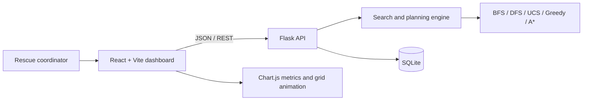
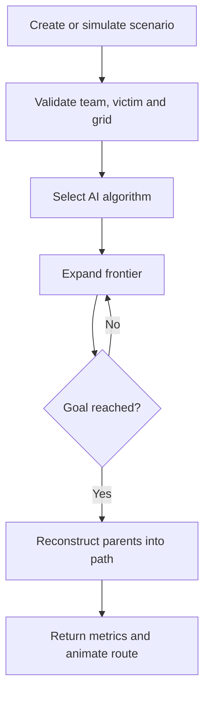

# Architecture and Flowcharts

The UI holds the map/grid state. Flask is the authoritative executor for planning and search. SQLite persists user and scenario records. Hazards and blocks are impassable (`-1`); poor roads carry a positive traversal cost.
