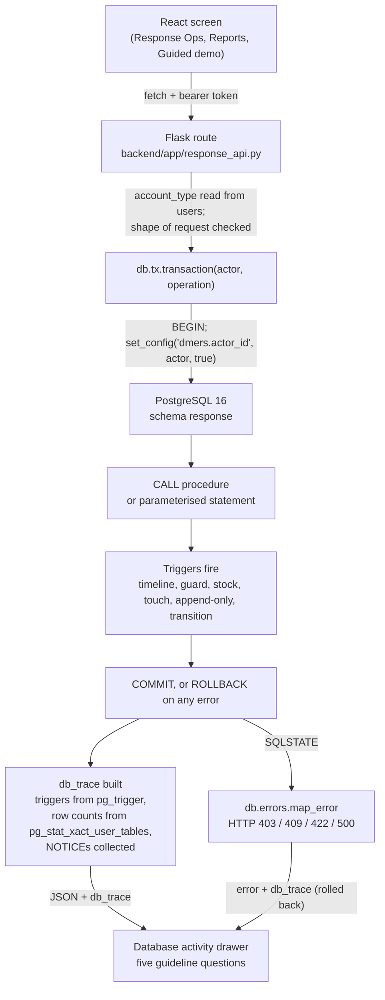

# Architecture: how a user operation reaches the database and comes back

## Request flow

Layers and files:

| Layer | File | Job |
|---|---|---|
| UI | `frontend/src/response/*` | Screens, the activity drawer, the guided demo, CSV and PDF export |
| API | `backend/app/response_api.py` | Auth, account-type check, request shape, calls the transaction layer |
| Transaction layer | `backend/db/tx.py` | One pooled transaction per operation, actor and note as session settings, NOTICE collection, trace |
| Errors | `backend/db/errors.py` | SQLSTATE and constraint name to a status and a readable message |
| Trace | `backend/db/trace.py` | Trigger and constraint catalogue read from the database |
| Pool | `backend/db/pool.py` | `psycopg_pool`, search path `response, public`, fork-safe |
| Migrations | `backend/db/migrate.py`, `backend/migrations/002_incident_response.sql` | Ordered, recorded, idempotent |
| Reports | `backend/db/reports.py` | The Review II queries, parameterised |
| Seed | `backend/db/seed.py` | Replays the Review II history through the triggers |

## Where each Review II object lives

Schema `response` holds `zones`, `incidents`, `response_units`, `resources`, `incident_updates`, `dispatches`,
`resource_allocations`, the view `v_zone_situation`, 3 functions, 2 procedures and 5 triggers, all with their Review II names.
`users` is not duplicated: the foreign keys and the procedures resolve `users` to `public.users`, which gained one derived column,
`account_type`, generated from the application's `role` (admin, official, responder, volunteer, citizen map to ADMINISTRATOR,
COORDINATOR, UNIT_LEAD, CITIZEN, CITIZEN). Review III added one trigger (`trg_incidents_transition_guard`) and one procedure
(`sp_update_dispatch`), documented in `PLAN.md` decision D7. Migration `003` adds a third, `trg_units_lead_type`, so that the lead of a response unit must hold a UNIT_LEAD account (Review I, Table 9, states the rule; Review II left it to the application). It is a separate migration because `002` was already applied to running databases, which also exercises the recorded-migration runner.

## Migration and rollback story

* `001` is the application baseline and is never edited. `002` is generated from the Review II files by
  `backend/db/tools/build_migration_002.py` and is idempotent (`IF NOT EXISTS`, `CREATE OR REPLACE`).
* The runner takes an advisory lock (two workers can start together), runs each file whole inside one transaction and records the
  version. A failed migration leaves nothing behind.
* Tested: 001 applied to a database that already holds users and legacy incidents, then 002 twice; existing rows are unchanged
  and `account_type` is derived correctly.
* To undo 002 by hand: `DROP SCHEMA response CASCADE; ALTER TABLE users DROP CONSTRAINT ck_users_account_type, DROP COLUMN account_type;
  DELETE FROM schema_migrations WHERE version = '002';`. No legacy table is touched by 002 apart from that one column.

## Design justifications

**Why the rules live in the database.** A rule in a trigger or procedure holds for every client: the API, a psql session, a script, a
future mobile app. Flask only decides who may call an endpoint (authorisation) and translates errors. The tests prove it: a busy unit
is refused by `trg_dispatches_guard` and a second dispatch race has exactly one winner whatever the application does.

**Why an AFTER trigger for stock.** The allocation row must exist before stock moves, and the same trigger must also run for `UPDATE OF quantity`
(the cumulative upsert) and `DELETE` (withdrawal). AFTER ROW lets it see the final row, move stock, refuse over-allocation with an exception
that rolls back the whole statement, and add the timeline note, all in the same transaction.

**Why a cursor for closing.** `sp_close_incident` must visit each active dispatch, decide per row (ON_SCENE becomes COMPLETED, others
CANCELLED), update that row and free its unit, and report one NOTICE per unit. A cursor `FOR UPDATE` with `WHERE CURRENT OF` locks exactly those rows
while iterating, which a single set-based UPDATE could not combine with the per-row decision and the per-row message.

**Why session variables for the audit author.** The triggers fire inside the database and cannot see the HTTP user. `set_config('dmers.actor_id', id, true)`
is transaction-local (the `true`), so it cannot leak to the next request on a pooled connection, and the timeline trigger writes `logged_by` without any
application code touching the timeline.

**Why a separate course database for Review II.** `dmers_course` keeps the coursework scripts runnable and resettable on their own (the reset script refuses to
run in `dmers`). Review III installs the same objects in schema `response` of the application database so they can share `users` and a transaction with the
application.

**Why `incidents` was not altered in place.** The legacy table already has a lowercase `severity`, anonymous public reports with a NULL reporter, and a verify step with no
zone, all of which Review II forbids. A separate schema keeps every existing flow unchanged (proved by regression tests) and keeps Review II names intact.

## The trace and what it can and cannot claim

* Triggers listed for a statement are read from `pg_trigger` (timing, events, `UPDATE OF` columns), never hard-coded; `verify_manifest` reports any documented
  trigger or procedure that is missing, and `/health` includes the result.
* Row counts come from PostgreSQL's per-transaction counters (`pg_stat_xact_user_tables`), so they include rows written by triggers and by the inside of procedures.
* A rolled-back trace lists only what ran: for a failed procedure the components come from the PL/pgSQL call stack in the error; effects are shown as unchanged.
* Limit: for a constraint failure (CHECK, UNIQUE, foreign key) the BEFORE triggers of the written tables are listed because PostgreSQL runs them first; this is inferred
  from its firing order, not observed. Procedure-internal writes are declared in `trace.PROCEDURE_WRITES` (the design) and are checked to exist, not to have executed.
* Statements in a trace contain placeholders, never parameter values.

## Security notes

All SQL is parameterised; identifiers are composed with `psycopg.sql.Identifier`. Every write endpoint requires a token and checks the account type in Flask; rules about data are
enforced by PostgreSQL. Demo-only endpoints (`/demo/*`, `/debug/edit-timeline`) answer 404 unless `DMERS_DEMO_MODE=1`; reset needs `DMERS_ALLOW_DEMO_SEED=1`. Password hashes are never
returned, exported or traced. Tokens expire after 8 hours. A connection pool is never shared across a fork (a real bug found during Review III testing: gunicorn `--preload`
created it in the master process and two workers shared its sockets, raising `DuplicatePreparedStatement`; fixed and covered by regression tests).
